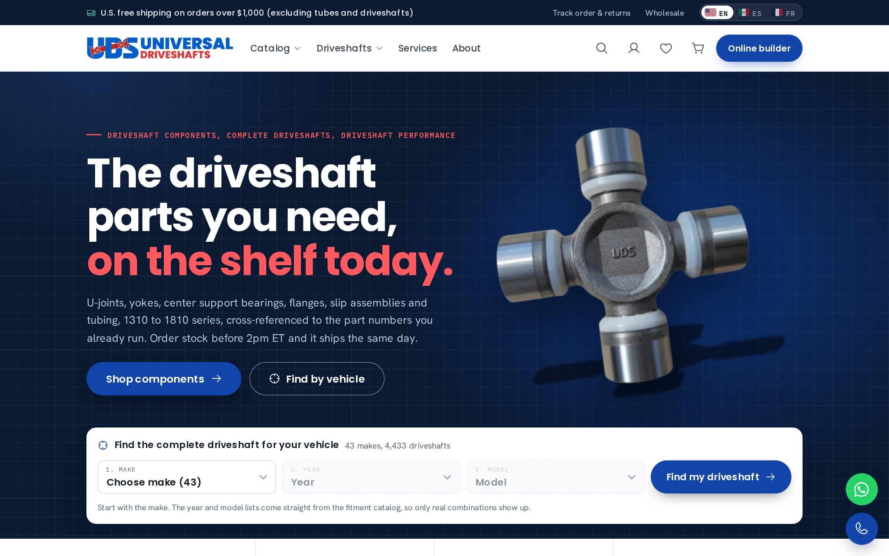
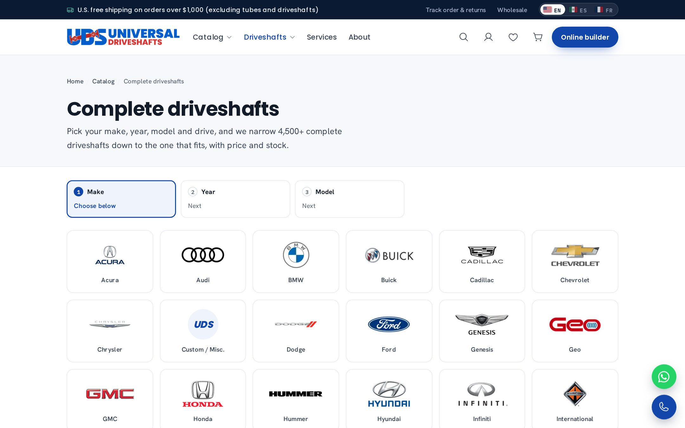
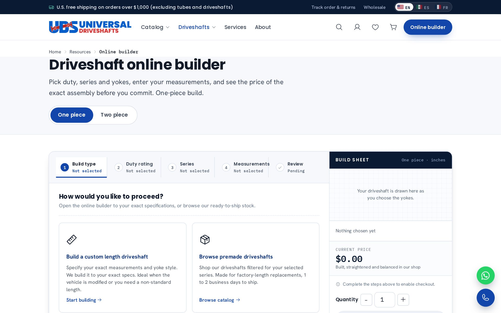
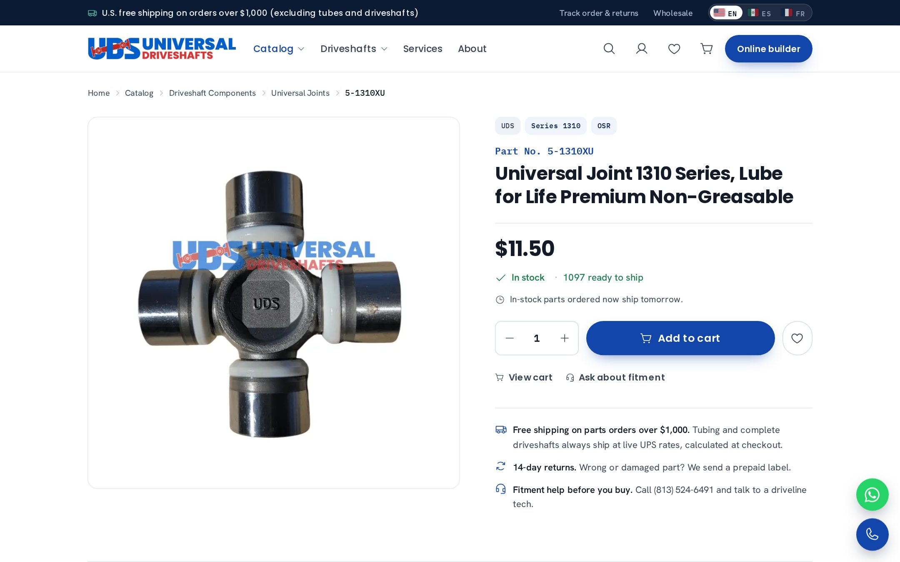
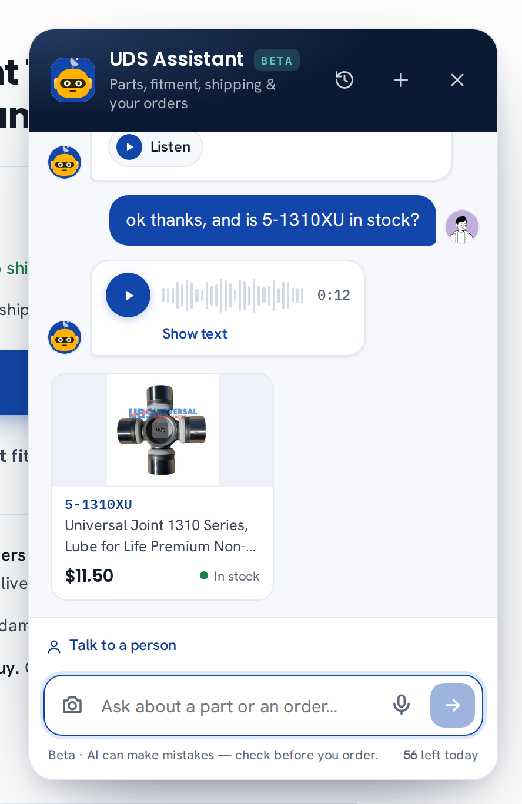

# Universal Driveshafts — Laravel storefront

A ground-up rebuild of [universaldriveshafts.com](https://universaldriveshafts.com) (a driveline manufacturer and parts store in Florida) from WordPress/WooCommerce into a Laravel 13 / PHP 8.3 storefront. Staging: [dev.udshafts.com](https://dev.udshafts.com). Launch: November 20, 2026.

Built and maintained by [Federico Leonel Schwindt](https://github.com/Federico-Schwindt). Online sales went from $2,982 (Oct 2024) to $18,819 (Oct 2026) with the same catalog and warehouse.



## What it does

**Catalog & search**
- 6,800+ parts and 4,400+ complete driveshafts, with live stock and pricing synced from the WooCommerce catalog (`catalog:localize`, hourly live-price overlay).
- Find-by-vehicle: year → make → model → the exact complete driveshaft, 43 makes.
- Cross-reference search: any Spicer / OE / import part number resolves to the matching UDS part.
- Grouped search (parts, driveshafts, guides) and a quick-order page for shops.

**Ordering**
- Checkout with Stripe (saved cards, opt-out), coupons, business-account pricing tiers (Bronze/Silver/Gold) and Net-20 terms.
- Shipping rated live through EasyPost (parcels, 50-lb bins, free-shipping rules) and Warp for LTL pallets; labels bought from the admin.
- Live order tracking (EasyPost with Shippo fallback) with e-mail and SMS updates; order status page; 14-day returns / RMA flow.
- Abandoned-cart recovery, stock and quote alerts, buy-again and also-bought.

**Driveshaft tools**
- Online builder: duty, series, yokes and six measurements → a priced custom driveshaft, no quote request.
- Driveshaft designer: draw and dimension a one- or two-piece shaft and print the sheet.
- Technical guides (u-joint series chart, how to measure, vibration diagnosis, angles) with schema markup.

**UDS Assistant (AI)**
- Signed-in store assistant on the Claude API with tool use: catalog search, shipping quotes, order tracking, returns, cart and ordering — by text or voice (ElevenLabs STT/TTS), with order/tracking widgets.
- Identifies a part from a photo: reads the brand and number, asks for cap diameter and width, matches the u-joint series and offers in-stock replacements even for other manufacturers' numbers (`App\Support\PartIdentifier`).

**Admin**
- Orders, labels, customers, coupons, inventory, driveshaft build specs, chat takeover, reports, roles (owner/admin/staff), settings store.

**Other**
- English, Spanish and French (`i18n:translate`), SEO routes and feeds, security headers, rate limits, WebP media cache, config/route caching.

## Stack

PHP 8.3 · Laravel 13 · MySQL · Blade + vanilla JS/CSS · Stripe · EasyPost · Warp · Twilio · Brevo · Anthropic Claude API · ElevenLabs · Playwright (tests/tooling) · Nginx

## Screenshots

| Find by vehicle | Online builder |
|---|---|
|  |  |

| Product page | AI assistant |
|---|---|
|  |  |

## Running it

```bash
composer install
cp .env.example .env && php artisan key:generate   # fill in DB, Stripe, EasyPost, Anthropic keys
php artisan migrate
php artisan catalog:localize                        # pull the catalog from the WooCommerce store
php artisan serve
```

Tests (MySQL-only migrations; uses transactions):

```bash
APP_CONFIG_CACHE=missing DB_CONNECTION=mysql DB_DATABASE=uds_app_dev php artisan test
```

## Notes

Product images, supplier data, uploads and the catalog snapshot are not in this repository. Secrets live in `.env` (see `.env.example`).
